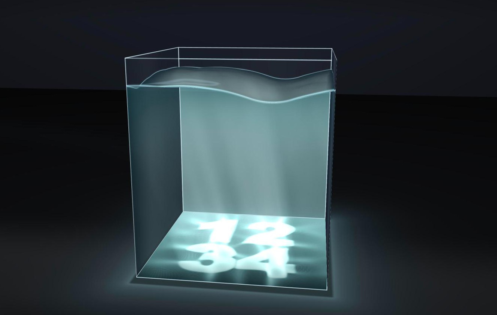

# CausticTankClock

水槽の底に落ちる光（コースティクス）で、現在時刻を `HHMM`（24 時間表記）として表示する時計。
WebGPU のみで動き、ビルド不要です。

A clock that shows the current time (24h `HHMM`) as the caustic light pattern on the floor of a water tank. Pure WebGPU, no build step.




## デモ / Live demo

https://toshinoritakata.github.io/CausticTankClock/

WebGPU 対応のブラウザ（Chrome など）で開いてください。見る人のブラウザのローカル時刻を表示します。
Open it in a WebGPU-capable browser (e.g. Chrome). It shows the viewer's local time.

## 仕組み / How it works

- 描きたい数字（目標のコースティクス）から、それを水底に作る**水面の形 h\*** を逆算します。
  モンジュ・アンペール方程式を、FFT によるポアソン解法の固定点反復で解きます（GPU の compute シェーダ）。
- 水面は、h\* を平衡点とする**減衰する波の運動方程式**で動きます。分が変わると目標が切り替わり、水面が波として次の数字へ落ち着きます。
- 水底の光は、水面の勾配から、斜めの平行光を正確に屈折（ベクトル版のスネルの法則）させて描きます。文字のテクスチャを投影しているわけではありません。
- 水中の光の筋（ゴッドレイ）は、深さごとのコースティクスを重ねた 3D データを、視線方向に進めて描きます。
- 常に小さな波を起こす連続的な外力（ambient waves）が入っています。

Surface design: Monge–Ampère fixed-point iteration with FFT Poisson solves on the GPU. Dynamics: damped wave equation relaxing to the designed surface. Floor caustic: exact vector-Snell oblique ray splatting. God rays: depth-sliced light volume, ray-marched.

## 実行 / Run

```sh
python3 -m http.server 8000
# http://localhost:8000/index.html を WebGPU 対応ブラウザ（Chrome など）で開く
```

## 主な操作 / Controls

| 操作 | 内容 |
|---|---|
| `c` | 時計モードの切り替え |
| `o` | 自動回転の切り替え（速さはスライダー） |
| `1` `2` `3` | カメラ位置（真上 / 斜め / 横） |
| `g` | ゴッドレイの切り替え |
| `f` | 全画面 |
| `d` / `r` | 波を揺らす / 最初から |
| ドラッグ / ホイール | 回転 / ズーム |

パネルの「Light」で光の高度・方位、「Solver / look」で波の解像度（128 / 256 / 512）やコースティクスの粗さを変えられます。

## 構成 / Files

- `index.html` — UI とモジュールの読み込み
- `app.js` — 全体の制御（時計、アニメーション、カメラ、描画パス）
- `solver.js` / `oblique.js` — 逆算ソルバーと斜め入射の光学
- `relax.js` — 波の運動方程式（減衰・復元力・連続的な外力）
- `godrays.js` — ゴッドレイの 3D 光データ
- `render.js` — 水面・ガラス・床・環境の描画シェーダ
- `cpu.js` / `solver_old.js` — 検証用の CPU 参照実装と旧ソルバー（デバッグ用フック）

## 動作環境 / Requirements

WebGPU と `float32-filterable` に対応したブラウザ。Apple Silicon の Mac 上の Chrome で開発・確認しています。他の GPU・ブラウザでは未確認です。

## ライセンス / License

MIT License. 詳細は [LICENSE](LICENSE) を参照してください。
